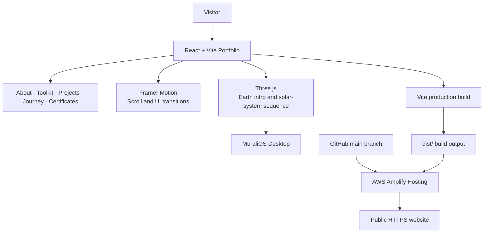

# MuraliOS — Personal Developer Portfolio

Explore the work. Discover the hidden archive.

**Live Demo:** [MuraliOS on AWS Amplify](https://main.d3lqg5tw7l2r3y.amplifyapp.com)  
**Source Code:** [vatlapatim-art/murali-portfolio](https://github.com/vatlapatim-art/murali-portfolio)

---

## About

MuraliOS is a personal developer portfolio built to present my projects, technical interests, achievements, and learning journey in one place. It combines a warm editorial interface with motion-led storytelling and interactive 3D experiences.

The main portfolio remains straightforward to navigate: visitors can explore the About, Toolkit, Projects, Journey, Certificates, and Contact sections. A separate interactive experience is tucked into the oversized **WORK** heading for visitors who want to explore further.

## Features

- **Cinematic Earth introduction** — an automatic Three.js fly-in that moves from a distant planetary view towards the surface and layered cloud deck before revealing the portfolio.
- **Scroll-led portfolio** — animated section reveals and project presentations, with regular navigation kept accessible.
- **Interactive WORK/O gateway** — a visible hint invites visitors to hover over or select the `O` to open the hidden experience.
- **Solar-system sequence** — an animated Sun, eight orbiting planets, Saturn's rings, an asteroid belt, orbital paths, and a star field lead into the desktop environment.
- **MuraliOS Desktop** — an optional interactive desktop containing a Project Explorer, Superpower Vending Machine, Guess My Stack, Fortune Cookie, Scratch Reveal, Theme Lab, and Developer Terminal.
- **Project gallery** — showcases software projects across geospatial intelligence, AI-assisted learning, graph analysis, emergency assistance, finance, and operating-systems concepts.
- **Certificate gallery** — previews and links to the certificates included with the portfolio.
- **Responsive experience** — layouts adapt to smaller screens, with reduced-motion handling and a fallback when WebGL is unavailable.

## Why it is different

MuraliOS is designed as more than a page of links and project cards. The portfolio has two complementary layers: a clear, conventional path for someone who wants to review my work, and an optional discovery experience for someone who wants to explore.

The `WORK/O` interaction is the entry point to that second layer. Rather than opening a terminal immediately, it starts a solar-system sequence and archive boot flow before revealing the desktop. The 3D scene remains present while the archive loads, keeping the interaction connected from start to finish.

The visual effects are there to support the story, not to replace the content. Project descriptions, repository links, certificates, and contact details remain part of the normal site.

## Projects

| Project | Overview | Repository |
|---|---|---|
| **CycloneShield** | Geospatial disaster-intelligence platform combining cyclone, flood, rainfall, terrain, wind, and infrastructure-exposure information. | [GitHub](https://github.com/vatlapatim-art/CycloneShield) |
| **AEGIS** | Emergency-assistance project exploring connected support and communication workflows. | [GitHub](https://github.com/vatlapatim-art/AEGIS) |
| **Social Network Clustering** | Graph analysis and spectral clustering using adjacency and Laplacian matrices, eigenvalue analysis, and interactive 3D visualization. | [GitHub](https://github.com/vatlapatim-art/Social_Network_Clustering) |
| **SmartStudy** | AI-assisted study workspace for organizing learning and supporting study workflows. | [GitHub](https://github.com/vatlapatim-art/SmartStudy) |
| **Arthiq** | Financial planning and education workspace focused on helping users understand their money and make informed plans. | [GitHub](https://github.com/vatlapatim-art/Arthiq) |
| **CampusCompute** | C-based distributed job-queue and worker-management simulation exploring scheduling, resource allocation, and worker-failure handling. | Learning project |

## Tech Stack

| Layer | Technology | Purpose |
|---|---|---|
| Frontend | React 18 | Component-based portfolio interface |
| Build tool | Vite 6 | Development server and production build |
| 3D graphics | Three.js | Earth introduction and solar-system experience |
| Motion | Framer Motion | UI transitions and scroll-led animations |
| Icons | Lucide React | Interface icons |
| Styling | CSS | Responsive layouts and visual design system |
| Source control | Git + GitHub | Version control and source repository |
| Hosting | AWS Amplify Hosting | Public hosting and Git-connected deployments |

## Architecture



## Setup

### Prerequisites

- Node.js 20 or newer
- npm
- Git (optional, for cloning the repository)

### Clone and run

```bash
git clone https://github.com/vatlapatim-art/murali-portfolio.git
cd murali-portfolio
npm install
npm run dev
```

Vite prints the local development URL, normally `http://localhost:5173/`.

### Production build

```bash
npm run build
npm run preview
```

The production files are generated in the `dist/` directory.

## Deployment

The repository includes `amplify.yml` for AWS Amplify Hosting.

1. Connect the GitHub repository to AWS Amplify.
2. Select the `main` branch.
3. Use `npm run build` as the frontend build command.
4. Set `dist` as the build output directory.
5. Save and deploy.

Once the repository is connected, new commits pushed to the connected branch can trigger a new Amplify deployment.

**Live website:** [https://main.d3lqg5tw7l2r3y.amplifyapp.com](https://main.d3lqg5tw7l2r3y.amplifyapp.com)

## Accessibility and performance

- The 3D experiences include a fallback for browsers where WebGL cannot initialize.
- Reduced-motion preferences are respected where motion is non-essential.
- The primary portfolio remains navigable without opening the hidden desktop experience.
- Local fallback textures are included for the Earth scene if its remote texture source is unavailable.

## Author

**Murali Manohar Vatlapati**  
Computer Science and Engineering student · PES University, Bengaluru

- GitHub: [vatlapatim-art](https://github.com/vatlapatim-art)
- LinkedIn: [Murali Manohar Vatlapati](https://www.linkedin.com/in/murali-manohar-vatlapati-3923b4417/)
- Email: [vatlapatim@gmail.com](mailto:vatlapatim@gmail.com)
